<div align="center">


<br/>

[](https://linkedin.com)
[](https://samoenterprises.site)
[](mailto:leonparranicolas@gmail.com)
[](https://github.com/Nicolas11Leon)

<br/>

[](https://github.com/SAMOenterprises)
[-0366d6?style=for-the-badge&logo=github&logoColor=white)](https://github.com/Trama-AS)
[](https://github.com/SR-PIZZA)

<br/>

**Systems Engineer specializing in high-performance Multiplatform Software Development (Mobile & Web), Scalable Backends, and Cloud Architecture.**<br/>
Lead Architect and Software Engineer with commercial systems deployed on Google Play Store and Apple App Store. Focused on Clean Architecture, Domain-Driven Design (DDD), and strict transactional concurrency.

<sub>Focus: Cross-Platform (Flutter · Compose Multiplatform · React) | Enterprise Backend (.NET · Node.js · Java · PostgreSQL / Supabase) | Cloud & Security (Google Cloud · CI/CD · freeRASP)</sub>

---

</div>

### Engineering Profile & Core Philosophy

```dart
class SystemsArchitect {
  final String name = 'Nicolás León Parra';
  final String primaryOrientation = 'Cross-Platform Engineering (Mobile & Web)';
  final String academicBackground = 'B.S. in Systems Engineering @ Pontificia Universidad Javeriana';
  final String specialization = 'Artificial Intelligence & Data Science Emphasis';

  final List<String> architecturalPrinciples = [
    'Clean Architecture & Domain-Driven Design (DDD)',
    'Single-source Multiplatform clients with reactive state management (BLoC)',
    'ACID transactional concurrency and race condition mitigation',
    'Defense-in-depth: Runtime Mobile Security (freeRASP) and Multi-tenant RLS',
    'Automated Quality Governance (SonarQube, GitFlow, DoR & DoD, CI/CD)',
  ];

  Map<String, dynamic> activeProductionWorkloads() {
    return {
      'flagship_ecosystem': 'S.A.M.O Match (Commercial Sports Management & Booking)',
      'deployments': ['Google Play Store', 'Apple App Store', 'Web Platform'],
      'multiplatform_suites': ['MANI Ecosystem (Flutter Web & Mobile)', 'Tunner (Acoustic Pitch Engine)'],
      'backend_architectures': ['MANI (.NET, Node.js, Java, API Gateway)', 'Sr. Pizza Omnichannel Platform'],
      'quality_standards': '1,400+ automated unit, widget, and integration tests with zero blocking defects',
    };
  }
}
```

---

### Technical Stack & Competencies

<div align="center">

| Layer | Technologies & Tools |
| :--- | :--- |
| **Multiplatform & Frontend** |         |
| **Backend & Services** |        |
| **Databases & Multi-Tenancy** |     -green?style=flat-square) |
| **Languages** |           |
| **Cloud, DevOps & QA** |       |
| **Architecture & Simulation** |      |

</div>

---

### Featured Systems & Commercial Showcases

| System / Repository | Domain & Architecture Stack | Engineering Highlights |
| :--- | :--- | :--- |
| **[S.A.M.O Match](https://github.com/SAMOenterprises/samo-ecosystem-showcase)**<br/><sub>[samoenterprises.site](https://samoenterprises.site) &bull; [SAMO Enterprises](https://github.com/SAMOenterprises)</sub> | **Commercial Sports Ecosystem**<br/>`Flutter` `BLoC` `PostgreSQL` `Supabase` `freeRASP` | Commercially deployed on **Google Play Store** and **Apple App Store**. Multi-tenant club ERP/POS with real-time cash reconciliation, atomic PL/pgSQL procedures preventing race conditions, dynamic ELO ranking engine, bracket seeding for tournaments, signed payment webhooks, and 1,400+ automated tests. |
| **[MANI Ecosystem](https://github.com/Trama-AS)**<br/><sub>[Trama-AS Organization](https://github.com/Trama-AS)</sub> | **End-to-End Enterprise Architecture**<br/>`Flutter` `Node.js` `.NET` `Java` `API Gateway` | Multi-tenant service operations platform managing client-ally lifecycles. Architected across decoupled services:<br/>&bull; **[MANI-Flutter](https://github.com/Trama-AS/MANI-Flutter):** Multiplatform client (Web & Mobile) with Clean Architecture and BLoC.<br/>&bull; **[MANI-Node](https://github.com/Trama-AS/MANI-Node):** High-throughput REST API and event coordination in Node.js.<br/>&bull; **[MANI-.NET](https://github.com/Trama-AS/MANI-.NET):** Enterprise domain service and transactional persistence in C# / .NET.<br/>&bull; **[MANI-Java](https://github.com/Trama-AS/MANI-Java):** Robust data processing and backend worker services.<br/>&bull; **[MANI-APIGateway](https://github.com/Trama-AS/MANI-APIGateway):** Centralized ingress routing and authentication enforcement. |
| **[Sr. Pizza Operations Showcase](https://github.com/SR-PIZZA/sr-pizza-showcase)**<br/><sub>[SR-PIZZA Organization](https://github.com/SR-PIZZA)</sub> | **Real-Time Delivery Logistics & Dispatch**<br/>`Node.js` `Express` `PostgreSQL` `WebSockets` | Production-grade omnichannel restaurant operations and street-level dispatch platform. Features real-time kitchen order ticketing (KDS), automated delivery driver allocation via low-latency WebSockets (<50ms), secure JWT RBAC authentication, and normalized PostgreSQL schemas with 89 E2E use cases verified. |
| **[Tunner](https://github.com/Nicolas11Leon/Tunner)** | **Acoustic Pitch Engine & Music Platform**<br/>`Flutter` `Dart` `Digital Signal Processing` | High-precision open-source musical pitch detection engine, multi-instrument/vocal tuner, and interactive sheet music transcription platform designed for real-time low-latency mobile audio processing. |
| **Airdrift (Indie Game)** | **Physics Simulation & Performance Tuning**<br/>`Unity 3D` `C#` `Blender 3D` | Lead Developer for indie racing video game. Engineered vehicle physics algorithms, responsive menus, performance profiling at 60 FPS, and custom 3D asset modeling in Blender. |

---

### Official Certifications

* **Google Cloud Cybersecurity Certificate** &mdash; *Google Cloud Skills Boost*  
  Validated competencies in cloud security principles, risk management, threat defense, IAM controls, and incident mitigation.
* **Google Cloud Data Analytics Certificate** &mdash; *Google Cloud Skills Boost*  
  Validated competencies in cloud storage, data transformation, ETL pipelines, BigQuery analysis, and data storytelling.
* **Cisco CCNA Studies** &mdash; *Pontificia Universidad Javeriana*  
  Network engineering fundamentals: routing protocols, switching, subnetting, TCP/IP architecture, and perimeter security.

---

### GitHub Analytics & Engineering Velocity

<div align="center">




<br/>


</div>

---

### Contact & Professional Verification

<div align="center">

[](mailto:leonparranicolas@gmail.com)
[](https://samoenterprises.site)
[](https://linkedin.com)

<br/>

<sub>Pontificia Universidad Javeriana &bull; Bogotá, Colombia &bull; Available for Senior Multiplatform, Systems Architecture & Engineering Roles</sub>

</div>
